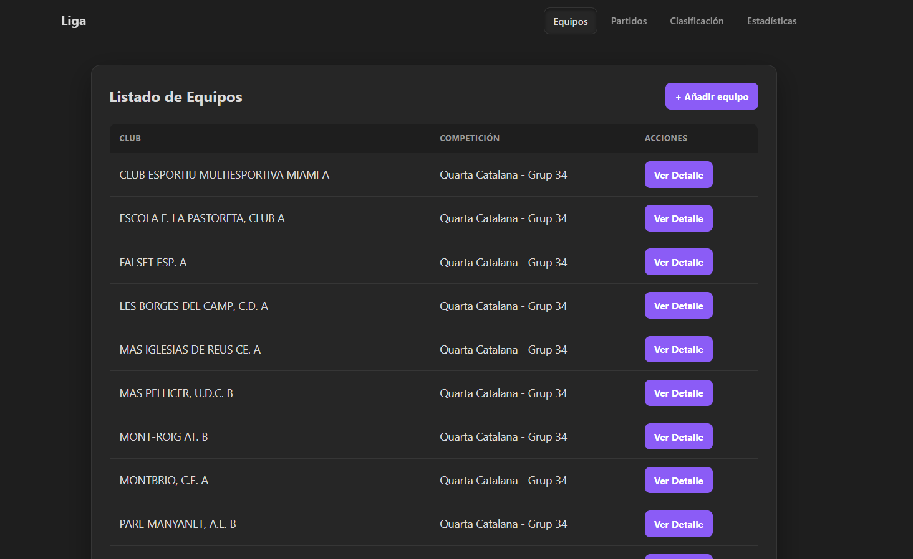
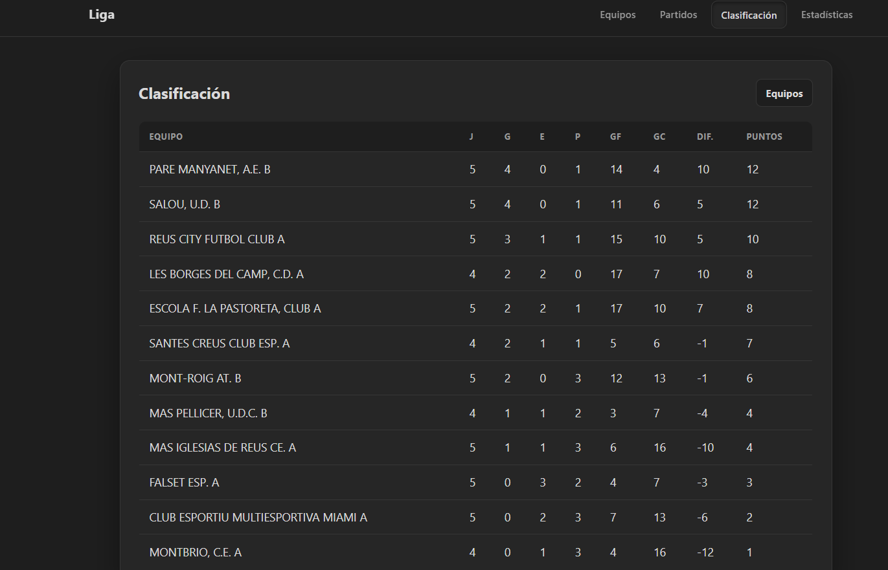

# Gestión de una liga de fútbol

Aplicación web sencilla para gestionar equipos, jugadores, jornadas y partidos de una liga. También muestra resultados, clasificación y estadísticas básicas.

## Tecnologías

- Java 17
- Spring Boot 4.1.1 y Maven Wrapper 3.9.16
- Spring MVC, Thymeleaf y Spring Data JPA
- H2 en archivo
- Lombok
- HTML y CSS propio

## Requisitos

- JDK 17 instalado y configurado en `JAVA_HOME`.
- No hace falta instalar Maven: el wrapper del proyecto descarga y utiliza Maven 3.9.16.

## Ejecutar la aplicación

Desde la carpeta del proyecto:

```bash
./mvnw spring-boot:run
```

En Windows PowerShell:

```powershell
.\mvnw.cmd spring-boot:run
```

Abre [http://localhost:8080](http://localhost:8080). La ruta `/` redirige al listado de equipos.

La base de datos se guarda en `data/liga.mv.db`. El directorio `data/` está excluido de Git; cada persona tendrá su propia base local. La consola H2 está en [http://localhost:8080/h2-console](http://localhost:8080/h2-console), con la URL JDBC `jdbc:h2:file:./data/liga`, usuario `sa` y contraseña vacía.

## Estructura del proyecto

El código Java está en `src/main/java/com/ligafutbol/api` y las vistas y recursos web en `src/main/resources`.

| Carpeta | Responsabilidad |
| --- | --- |
| `models` | Entidades y clases que representan los datos de la liga. |
| `repositories` | Consultas y operaciones de persistencia con Spring Data JPA. |
| `services` | Validaciones y reglas de negocio. |
| `controllers` | Rutas web; preparan el modelo y eligen la vista o redirección. |
| `resources/templates` | Plantillas HTML de Thymeleaf. |
| `resources/static/css` | Hojas de estilos. |

### Clases principales

**Modelos**

- `Team`: equipo, nombre, grupo de competición y jugadores.
- `Player`: jugador, nombre, dorsal y equipo al que pertenece.
- `Match`: jornada, equipos local y visitante, estado, marcador opcional y eventos.
- `MatchStatus`: estados `SCHEDULED`, `IN_PROGRESS` y `FINISHED`.
- `Event`: tipo de evento, minuto y jugador asociado.
- `EventType`: `GOAL`, `YELLOWCARD` y `REDCARD`.
- `ClassificationLine`: datos calculados de un equipo en la clasificación (partidos, victorias, empates, derrotas, goles y puntos).

**Repositorios**

- `TeamRepository`: guarda equipos y busca por nombre o grupo.
- `PlayerRepository`: guarda jugadores y los busca por equipo.
- `MatchRepository`: guarda partidos y los busca por jornada, estado o equipo.

**Servicios**

- `TeamService`: crea, edita, lista, busca y elimina equipos con sus validaciones.
- `PlayerService`: añade y lista jugadores.
- `MatchService`: crea, lista, busca y termina partidos.
- `EventService`: añade goles o tarjetas a un partido.
- `ClassificationService`: calcula la clasificación de `Quarta Catalana - Grup 34` usando los partidos finalizados.
- `FcfLeagueImport`: al iniciar la aplicación importa el calendario incluido en `resources/data/fcf-2026-27.txt`, si los partidos aún no existen.
- `DemoDataSeeder`: reemplaza los nombres de jugadores por nombres ficticios, completa las plantillas hasta 15 jugadores y añade goleadores y tarjetas de demostración a los partidos finalizados. Los marcadores importados se conservan.

**Controladores**

- `HomeController`: redirige `/` a `/teams`.
- `TeamController`: gestiona equipos y sus formularios.
- `PlayerController`: lista jugadores y permite añadirlos a un equipo.
- `MatchController`: gestiona calendario, resultados, partidos y eventos.
- `ClassificationController`: muestra clasificación y estadísticas.

**Vistas**

- Equipos: `teams.html`, `team-form.html`, `team-edit.html`, `team-detail.html` y `team-addPlayer.html`.
- Jugadores: `detailsPlayers.html`.
- Partidos: `calendar.html`, `matchesResults.html`, `match-form.html`, `match-detail.html` y `event-form.html`.
- Clasificación y estadísticas: `classification.html` y `statistics.html`.
- Menú común: `fragments/nav.html`.

## Rutas

| Método | Ruta | Función |
| --- | --- | --- |
| GET | `/` | Redirige a `/teams`. |
| GET | `/teams` | Lista equipos. |
| GET | `/teams/new` | Muestra el formulario de equipo. |
| POST | `/teams` | Crea un equipo. |
| GET | `/teams/{id}` | Muestra el equipo y sus jugadores. |
| GET | `/teams/{id}/edit` | Muestra el formulario de edición. |
| POST | `/teams/{id}/edit` | Guarda los cambios del equipo. |
| POST | `/teams/{id}/delete` | Elimina el equipo si no tiene jugadores. |
| GET | `/teams/{teamId}/addPlayer` | Muestra el formulario para añadir jugador. |
| POST | `/teams/{teamId}/addPlayer` | Añade un jugador al equipo. |
| GET | `/players` | Lista todos los jugadores. |
| GET | `/players/team/{teamId}` | Lista los jugadores de un equipo. |
| GET | `/calendar` o `/matches` | Muestra el calendario de partidos. |
| GET | `/matches/results` | Muestra partidos finalizados. |
| GET | `/matches/new` | Muestra el formulario de partido. |
| POST | `/matches` | Crea un partido. |
| GET | `/matches/{id}` | Muestra el detalle de un partido. |
| GET | `/matches/{id}/events/new` | Muestra el formulario de evento. |
| POST | `/matches/{id}/events` | Añade un gol o tarjeta al partido. |
| POST | `/matches/{id}/finish` | Marca el partido como finalizado. |
| GET | `/classification` | Muestra la clasificación. |
| GET | `/statistics` | Muestra estadísticas de la clasificación. |

## Modelos y relaciones

- Un `Team` tiene varios `Player`; cada `Player` pertenece a un `Team`.
- Un `Match` tiene un equipo local y uno visitante. Su estado es `MatchStatus`.
- Un `Match` puede contener varios `Event`; cada evento está asociado a un `Player`.
- `ClassificationLine` no es una entidad almacenada: el servicio la construye al calcular la tabla.
- El marcador puede estar guardado directamente en el partido. Si no lo está, se calcula contando sus eventos `GOAL` según el equipo del jugador.

## Reglas de negocio existentes

- El nombre y el grupo del equipo son obligatorios, no pueden superar 255 caracteres y no se permiten nombres de equipo duplicados ignorando mayúsculas/minúsculas.
- No se puede borrar un equipo que tenga jugadores.
- El nombre del jugador es obligatorio y admite hasta 255 caracteres; el dorsal va de 1 a 99.
- La jornada debe ser mayor que cero y los equipos local y visitante deben ser distintos y existir.
- Los eventos necesitan tipo, minuto entre 1 y 120 y un jugador de uno de los dos equipos del partido. No se admiten eventos en partidos finalizados.
- La clasificación cuenta únicamente partidos finalizados del grupo indicado. Otorga 3 puntos por victoria y 1 por empate; ordena por puntos, diferencia de goles, goles a favor y nombre.
- El calendario incluido tiene 22 jornadas y se carga sin duplicar partidos ya existentes. En los partidos con resultado publicado, se usa el marcador guardado.
- Los nombres, goleadores y tarjetas generados por `DemoDataSeeder` son datos ficticios de demostración, no datos reales de jugadores ni actas oficiales.

## Ejemplo de flujo: añadir equipo

1. El navegador envía `POST /teams` con el nombre y el grupo.
2. `TeamController` recibe los campos y llama a `TeamService.addTeam`.
3. `TeamService` valida los datos y consulta `TeamRepository` para comprobar que el nombre no esté repetido.
4. El repositorio guarda el equipo en H2.
5. El controlador redirige a `/teams`; la plantilla `teams.html` muestra el listado.

## Capturas de pantalla

## Listado de equipos

## Clasificación


## Posibles mejoras

- Añadir fechas y sedes de los partidos.
- Importar las plantillas completas de jugadores si se dispone de esos datos.
- Añadir pruebas para controladores y formularios.
- Permitir gestionar más de una competición desde la clasificación.
